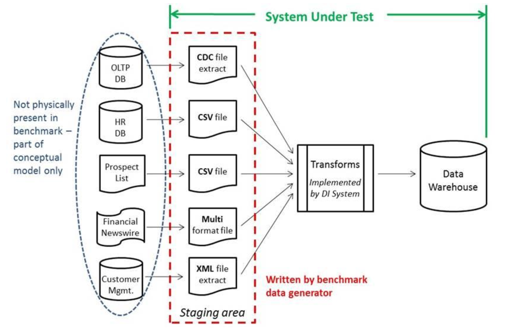
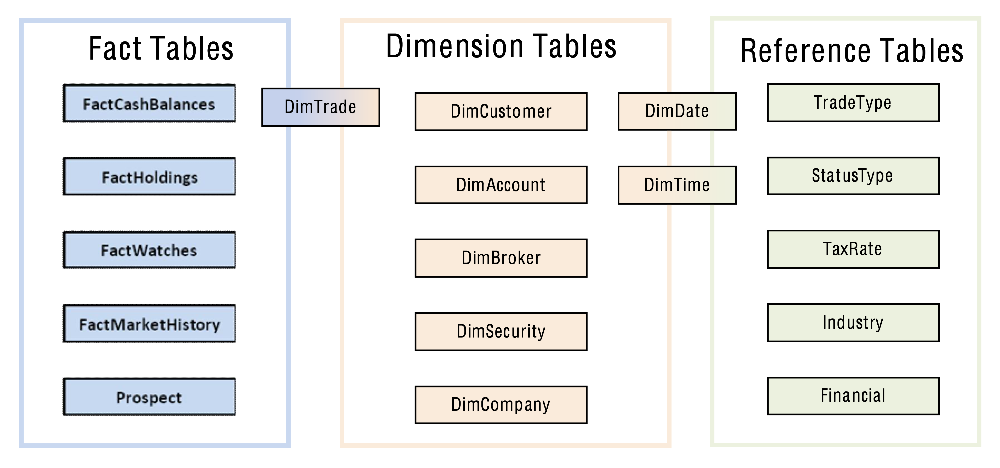

# What is this?
This project contains two distinct portions:
1. A CLI developed using the [BigQuery](https://cloud.google.com/python/docs/reference/bigquery/latest) and [Cloud Storage](https://cloud.google.com/python/docs/reference/storage/latest) Python clients and [Typer](https://typer.tiangolo.com/). This CLI creates tables in BigQuery for the files generated by the [TPC-DI](https://www.tpc.org/tpcdi/) benchmark specification.
2. A [dbt](https://www.getdbt.com/) project using [Snowflake Dynamic Tables](https://docs.snowflake.com/en/user-guide/dynamic-tables-about) for building the data warehouse defined in the TPC-DI specification.




I should be clear in my goal here: I am not attempting to _actually run and measure_ the TPC-DI benchmark.
The `tpcdi.py` CLI in this repository is single-threaded and ingests the data sequentially, which would be the worst approach if trying to optimize for a benchmark.
Instead, I needed a dataset that could be used to mimic data engineering workloads inside of BigQuery, so I just wanted the files loaded.





I took a few liberties with the TPC-DI specification to update it a bit for Snowflake. I replaced `CamelCase` names with `SNAKE_CASE`, mostly out of irritation with readability.
Secondly, I just couldn't stand for having the `DimTrade` table be "both a dimension table and a fact table, depending on how it is being used" as it was designed by TPC-DI.
This decision was made during an era when storage and compute were constrained, so in my design, I created both `DIM_TRADE` and `FACT_TRADE` tables.
Finally, I used a Medallion Lakehouse Architecture with Bronze, Silver, and Gold zones, with the logical model above materialized in the Gold zone.

# Using DIGen.jar to Generate Source Files
The Java program to generate the source files is downloaded by [filling out a form on the TPC-DI website](https://www.tpc.org/TPC_Documents_Current_Versions/download_programs/tools-download-request5.asp?bm_type=TPC-DI&bm_vers=1.1.0&mode=CURRENT-ONLY) and clicking a link in an email. Once unzipped, we have to make one slight change for running on macOS:

```bash
unzip 66a2b600-af36-4198-bfbc-c94c40cc22af-tpc-di-tool.zip && \
mv Tools/PDGF Tools/pdgf && \ #clearly written on a case-insensitive OS
cd Tools
```

I couldn't find any way to execute the provided JAR with a Java version newer than `1.8`. I spent some time trying to rebuild the JAR file using a newer Java version for posterity, but it was a fool's errand.
I installed [Azul Zulu Java 1.8](https://www.azul.com/downloads/?package=jdk#zulu) and used [jEnv](https://www.jenv.be/) to set a local version, and with that, we can see the help context from the JAR:

```
jenv add /Library/Java/JavaVirtualMachines/zulu-8.jdk/Contents/Home && \
jenv local 1.8 && \
java -jar DIGen.jar --help

usage: DIGen
 -h                   print this message
 -jvm <JVM options>   JVM options. E.g. -jvm "-Xms1g -Xmx2g"
 -o <directory>       Specify output directory.  Default is output.
 -sf <sf>             Scale factor.  Default value is 5. (range: 3 -
                      2147483647
 -v                   print DIGen version
 ```

This utility will generate a bunch of different data files in various formats with a scaling (or multiplication) factor determining how much data the files contain. 
It attempts to mimic ETL processes at the time the specification was written, which generally utilized file extracts from source systems. It generates CSVs and pipe-separated files (PSVs?), which are quite simple with BigQuery load jobs. 
The two file formats that proved the most fun and challenging were fixed-width fields and XML, as both required heavy transformations: the fixed-width FINWIRE files are parsed with SQL, and since BigQuery has no native XML reader, `CustomerMgmt.xml` is parsed in Python. The files are generated in batches, with `Batch1` representing the historical load, and `Batch2` and `Batch3` representing various incremental loads. 
Currently, I've only tested the loader against `Batch1` and the dbt models have not yet been extended to handle additional batches. 
Also, I haven't yet implemented the Audit portion of the specification, which is somewhat embarrassing as a former co-founder of a data quality company.

```bash
java -jar DIGen.jar -o <path-to-this-repo>/digen-files -sf 10 && \
ls -lhtr <path-to-this-repo>/digen-files/Batch1

-rw-r--r--  1 stewartbryson  staff    52B Jul 21 14:30 StatusType_audit.csv
-rw-r--r--  1 stewartbryson  staff    89B Jul 21 14:30 StatusType.txt
-rw-r--r--  1 stewartbryson  staff    52B Jul 21 14:30 TaxRate_audit.csv
-rw-r--r--  1 stewartbryson  staff    17K Jul 21 14:30 TaxRate.txt
-rw-r--r--  1 stewartbryson  staff    52B Jul 21 14:30 Date_audit.csv
-rw-r--r--  1 stewartbryson  staff   3.3M Jul 21 14:30 Date.txt
-rw-r--r--  1 stewartbryson  staff    52B Jul 21 14:30 Time_audit.csv
-rw-r--r--  1 stewartbryson  staff   4.6M Jul 21 14:30 Time.txt
-rw-r--r--  1 stewartbryson  staff    12B Jul 21 14:30 BatchDate.txt
-rw-r--r--  1 stewartbryson  staff   3.9M Jul 21 14:30 HR.csv
-rw-r--r--  1 stewartbryson  staff    84B Jul 21 14:30 HR_audit.csv
-rw-r--r--  1 stewartbryson  staff   391B Jul 21 14:30 CustomerMgmt_audit.csv
-rw-r--r--  1 stewartbryson  staff    30M Jul 21 14:30 CustomerMgmt.xml
-rw-r--r--  1 stewartbryson  staff    10M Jul 21 14:30 Prospect.csv
-rw-r--r--  1 stewartbryson  staff   141B Jul 21 14:30 Prospect_audit.csv
-rw-r--r--  1 stewartbryson  staff    52B Jul 21 14:30 Industry_audit.csv
-rw-r--r--  1 stewartbryson  staff   2.6K Jul 21 14:30 Industry.txt
-rw-r--r--  1 stewartbryson  staff    81K Jul 21 14:30 FINWIRE1967Q1
-rw-r--r--  1 stewartbryson  staff   219B Jul 21 14:30 FINWIRE1967Q1_audit.csv
-rw-r--r--  1 stewartbryson  staff    77K Jul 21 14:30 FINWIRE1967Q2

{ Truncated }
```

# The BigQuery Loader: tpcdi.py
The environment is managed with [uv](https://docs.astral.sh/uv/). Dependencies are declared in `pyproject.toml` and pinned in `uv.lock`, and `.python-version` selects the Python version, which uv will download if needed:

```bash
uv sync && \
uv run tpcdi.py --help
```

The loader uses Typer for the CLI interface, Cloud Storage as the stage for uploading files, and BigQuery load jobs and SQL for creating the tables -- in some cases doing heavy transformations along the way.
Authentication uses [Application Default Credentials](https://cloud.google.com/docs/authentication/provide-credentials-adc), so nothing secret lives in the repository:

```bash
gcloud auth application-default login
```

Every option that describes *where* data goes can be passed on the command line or set with an environment variable:

| Option       | Environment variable | Default                 | Purpose                                           |
|--------------|----------------------|-------------------------|---------------------------------------------------|
| `--project`  | `TPCDI_PROJECT`      | the ADC default project | GCP project for BigQuery and Cloud Storage        |
| `--dataset`  | `TPCDI_DATASET`      | `tpcdi`                 | BigQuery dataset the tables are written to        |
| `--location` | `TPCDI_LOCATION`     | `US`                    | Location for the dataset (and bucket, if created) |
| `--bucket`   | `TPCDI_BUCKET`       | *(required)*            | GCS bucket used as the stage                      |
| `--prefix`   | `TPCDI_PREFIX`       | `tpcdi`                 | Path prefix in the bucket; the "stage" name       |

```bash
export TPCDI_PROJECT=my-project
export TPCDI_BUCKET=my-tpcdi-bucket
export TPCDI_DATASET=tpcdi
```

The dataset is created if it doesn't exist. The bucket must already exist, or can be created with `uv run tpcdi.py recreate-stage`.
Loading the files is accomplished with the `process-files` command, which reads from the `digen-files` directory by default; use `--input-directory` if your DIGen output lives somewhere else:

```
❯ uv run tpcdi.py process-files --help
```

Let's start by loading a rather simple file - the `StatusType.txt` which is pipe-delimited.
I'll first demonstrate the `--show` option, which writes to a `status_type__preview` table that expires after an hour and prints a sample of it, leaving the real table alone.
Then I'll load the table:

```
❯ uv run tpcdi.py process-files --file-name StatusType.txt --show

❯ uv run tpcdi.py process-files --file-name StatusType.txt

❯ bq query --use_legacy_sql=false 'select * from tpcdi.status_type'
```

Notice that the second execution skipped uploading the file because it already existed in the stage, which can be overridden with the `--overwrite` option.
For now, let's get the rest of the files loaded so we can move on to the dbt models.
All tables are written with `WRITE_TRUNCATE` or `CREATE OR REPLACE`, so we can run it again without duplicating data:

```
❯ uv run tpcdi.py process-files
```

When you're finished, `drop-stage` removes the uploaded files from the bucket and `drop-dataset` removes the dataset and all of its tables.

# Contributing and Releases
Releases are automated with [release-please](https://github.com/googleapis/release-please), which relies on [Conventional Commits](https://www.conventionalcommits.org/):

- Pull requests are squash-merged, and the PR title becomes the commit message on `main`, so PR titles must follow the Conventional Commits format (e.g. `feat: load Batch2 files` or `fix: handle empty C_TIER`). A PR check enforces this.
- Every PR also runs `uv sync --locked`, `ruff check`, `ruff format --check`, and a CLI smoke test. Run them locally with:

  ```bash
  uv run ruff check && uv run ruff format --check && uv run tpcdi.py --help
  ```

- After changes land on `main`, release-please opens (or updates) a release PR that bumps the version in `pyproject.toml` and `uv.lock` and updates `CHANGELOG.md`. Merging that PR creates the Git tag and GitHub Release.
- Until `1.0.0`, `feat:` commits bump the patch version and breaking changes (`feat!:`) bump the minor version.
